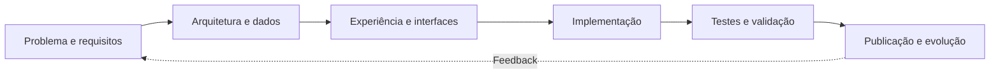

 

**Web Development · SaaS Applications · Editorial Platforms · Digital Experiences**

Soluções digitais com foco em **identidade, arquitetura, usabilidade e evolução contínua**.

[**🇧🇷 Português**](#olá-sou-henry-ribeiro) &nbsp;•&nbsp; [**🇺🇸 English**](./docs/english.md) &nbsp;•&nbsp; [**Projetos**](#projetos-selecionados) &nbsp;•&nbsp; [**Engenharia**](#como-penso-em-engenharia) &nbsp;•&nbsp; [**Tecnologias verificadas**](./docs/tecnologias.md)

---

## Olá, sou Henry Ribeiro.

Atuo na concepção, no desenvolvimento e na evolução de **portais de conteúdo, experiências de leitura e aplicações web para operações de negócio**. Meu trabalho envolve a experiência de quem utiliza o produto e os mecanismos que sustentam sua operação: regras de negócio, conteúdo, acesso a dados, administração e publicação.

Tenho especial interesse em **arquitetura de sistemas, bancos de dados, segurança da informação, ferramentas administrativas e integração de serviços**.

> **Meu objetivo:** transformar necessidades concretas em aplicações claras para o usuário e organizadas para evoluir.

Este GitHub reúne **estudos de caso de três projetos**, documentação de decisões técnicas e uma visão verificável das tecnologias presentes em cada ecossistema. Os repositórios de produção permanecem privados.

### Navegação rápida — também no celular

- **[📰 Sem Filtro Notícias](./docs/sem-filtro-noticias.md)** — portal jornalístico e fábrica de portais. [Acessar site](https://www.tvsemfiltronoticias.com.br).
- **[🏙️ RadarImob](./docs/radar-imob.md)** — plataforma SaaS imobiliária e estudo de arquitetura.
- **[📚 Leninha Digital · Mundo dos E-books](./docs/leninha-digital.md)** — experiência pública de leitura. [Acessar site](https://www.leninhadigital.com.br).
- **[🏗️ Engenharia](./docs/engenharia.md)** — processo, qualidade e segurança.
- **[🧩 Tecnologias](./docs/tecnologias.md)** — matriz técnica por projeto.
- **[🌎 English](./docs/english.md)** — apresentação em inglês.

## Tecnologias identificadas nos meus projetos

Stack identificada nos manifestos e na documentação dos projetos. A presença de uma tecnologia não implica uso em todas as aplicações ou domínio individual uniforme de cada ferramenta. Consulte a <a href="./docs/tecnologias.md">matriz de evidências</a>.

## Projetos selecionados

### 📰 01 · Sem Filtro Notícias

**Jornalismo regional · Gestão editorial · Fábrica de portais**

Plataforma voltada à publicação jornalística e à evolução de portais regionais com identidades próprias. O produto reúne experiência de leitura pública, navegação editorial e funcionalidades de administração de conteúdo.

| Perspectiva | Trabalho documentado |
| :-- | :-- |
| **Produto** | Notícias, editorias, navegação e organização editorial |
| **Interface** | Layouts responsivos, leitura em diferentes telas, identidade de portais |
| **Administração** | Gestão de conteúdo e configurações |
| **Engenharia** | Organização de aplicações, validação e evolução de múltiplos portais |
| **Stack verificada** | React, TypeScript, Next.js, Tailwind CSS e Node.js |

**Desafio central:** manter a consistência da experiência editorial sem misturar identidade e configurações de diferentes portais.

[**🌐 Acessar o portal público**](https://www.tvsemfiltronoticias.com.br) &nbsp;·&nbsp; [**📘 Ler o estudo de caso**](./docs/sem-filtro-noticias.md)

---

### 🏙️ 02 · RadarImob

**SaaS imobiliário · Carteiras de imóveis · Relacionamento comercial**

Projeto de aplicação web para corretores, concebido para organizar imóveis, clientes, leads e processos de atendimento. O escopo técnico inclui painéis privados, presença pública de imóveis e recursos de suporte à jornada comercial.

| Perspectiva | Trabalho documentado |
| :-- | :-- |
| **Produto** | Gestão de imóveis, clientes, oportunidades e atendimento |
| **Dados** | Modelagem relacional e contexto de múltiplas contas |
| **Interfaces** | Painéis de operação e experiências públicas de imóveis |
| **Arquitetura** | Separação de contextos e responsabilidades de acesso |
| **Stack verificada** | Next.js, React, TypeScript, Prisma e PostgreSQL |

**Desafio central:** conciliar dados de diferentes contas, experiência pública e fluxos privados de operação em um produto SaaS.

[**📘 Ler o estudo de caso**](./docs/radar-imob.md) &nbsp;·&nbsp; *Apresentação técnica sob consulta*

*O estudo apresenta o escopo encontrado na documentação e no deploy; não atesta a disponibilidade operacional de todas as funções.*

---

### 📚 03 · Leninha Digital / Mundo dos E-books

**Leitura digital · Conteúdo · Administração**

Projeto web orientado à experiência de leitura e organização de conteúdo digital, com ferramentas para administração e recursos relacionados ao tratamento e à apresentação de documentos.

| Perspectiva | Trabalho documentado |
| :-- | :-- |
| **Produto** | Catálogo, materiais digitais e experiência de leitura |
| **Interface** | Navegação e leitura em diferentes dispositivos |
| **Conteúdo** | Editor e ferramentas associadas a e-books |
| **Dados** | Persistência e organização das informações da aplicação |
| **Stack verificada** | React, Vite, libSQL, Drizzle ORM, Tiptap e PDF.js |

**Desafio central:** criar uma experiência de leitura centrada no conteúdo, mantendo os fluxos de gestão separados dos fluxos do leitor.

[**🌐 Acessar a Leninha Digital**](https://www.leninhadigital.com.br) &nbsp;·&nbsp; [**📘 Ler o estudo de caso**](./docs/mundo-dos-ebooks.md) &nbsp;·&nbsp; [**📱 Conhecer a versão pública**](./docs/leninha-digital.md)

*O site Leninha Digital é a apresentação pública do projeto Mundo dos E-books; não se trata de um quarto projeto independente. O repositório de produção permanece privado.*

## Como penso em engenharia

Um projeto bem apresentado precisa também ter um processo técnico compreensível.

| Pilar | Princípio aplicado |
| :-- | :-- |
| **Arquitetura** | Limites claros entre interface, dados, serviços e regras de negócio |
| **UX/UI** | Navegação, legibilidade, contraste e comportamento em diferentes telas |
| **Dados** | Modelagem coerente e atenção ao isolamento de informações |
| **Segurança** | Autenticação, autorização, proteção de segredos e validação de entradas |
| **Qualidade** | Revisões e verificações técnicas proporcionais ao projeto |
| **Manutenção** | Versionamento e melhorias incrementais que permitam rastrear alterações |

O diagrama representa o **fluxo conceitual de desenvolvimento**, não a infraestrutura privada de produção.

[**Explorar meu processo de engenharia →**](./docs/engenharia.md)

## Visão técnica dos projetos

| Projeto | Aplicação principal | Persistência / dados | Validação |
| :-- | :-- | :-- | :-- |
| **Sem Filtro Notícias** | Ecossistema React/Next.js e ferramentas Node.js | Integrações SQL/libSQL identificadas | Scripts de build, lint, typecheck e teste |
| **RadarImob** | Next.js, React, TypeScript | Prisma e PostgreSQL/Neon | Scripts de teste e validação identificados |
| **Mundo dos E-books** | React e Vite | libSQL e Drizzle ORM | Testes de aplicação e ferramentas de verificação |

*Tabela descritiva baseada em arquivos de configuração e documentação consultados. Scripts presentes não equivalem a auditoria independente nem garantem cobertura integral de testes.*

## Princípios e evolução

- **A experiência precisa servir ao negócio:** interface visual e fluxo operacional devem trabalhar juntos.
- **Cada sistema tem seu próprio contexto:** não existe arquitetura única para um portal editorial, um SaaS imobiliário e uma plataforma de leitura.
- **Identidade importa:** páginas e painéis devem refletir o produto a que pertencem.
- **Segurança faz parte do desenho:** dados, permissões e credenciais não devem ficar expostos em um portfólio público.
- **Evolução exige disciplina:** mudanças devem ser rastreáveis, revisáveis e, quando necessário, reversíveis.

## English summary

I develop and evolve **web products, digital publishing experiences, and business-oriented applications**. My selected work covers a regional news platform, a real estate SaaS product, and a digital reading platform.

My documentation focuses on real product scope, technologies identified in project files, engineering challenges, and transparent technical presentation. Production code and sensitive configurations remain private.

[**Read the complete English portfolio →**](./docs/english.md)

## Formação acadêmica e capacitações concluídas

Minha trajetória de formação reúne conhecimentos em tecnologia, ciências humanas, educação, ciências biológicas, direito e investigação. Essa base multidisciplinar contribui para uma visão mais ampla sobre desenvolvimento de produtos, pesquisa, análise de informações e necessidades de diferentes públicos.

| Tecnologia e sistemas | Ciências humanas e educação | Ciências, direito e investigação |
| :-- | :-- | :-- |
| Análise e Desenvolvimento de Sistemas | Sociologia | Biologia |
| Gestão da Tecnologia da Informação | Pedagogia | Direito |
| Banco de Dados |  | Investigação Forense e Perícia Criminal |
|  |  | Neurociência |

**Situação informada:** formações e capacitações concluídas. Como não foram especificados os níveis e as instituições de cada formação, os itens não são classificados individualmente como graduação, pós-graduação ou curso livre.

## Contato, colaboração e demonstrações

Tenho interesse em conversar sobre desenvolvimento web, aplicações de negócio, plataformas de conteúdo, segurança e evolução de sistemas.

**[Perfil GitHub](https://github.com/henryribeirofiscalizacao-ctrl)** · **[Sem Filtro Notícias](https://www.tvsemfiltronoticias.com.br)** · **[Estudos de caso](#projetos-selecionados)** · **[README preparado para o perfil](./PROFILE-README.md)**

### Transparência e confidencialidade

Este é um portfólio de apresentação. **Repositórios de produção, código proprietário, credenciais, dados de clientes e configurações internas permanecem privados.**

A documentação descreve funcionalidades e tecnologias identificadas, sem afirmar que todas as capacidades previstas estejam disponíveis ou que todos os sistemas tenham passado por auditorias independentes.

---

<strong>Henry Ribeiro</strong> · Desenvolvimento web, sistemas digitais e engenharia aplicada

Projetos reais · Documentação técnica · Código de produção preservado

