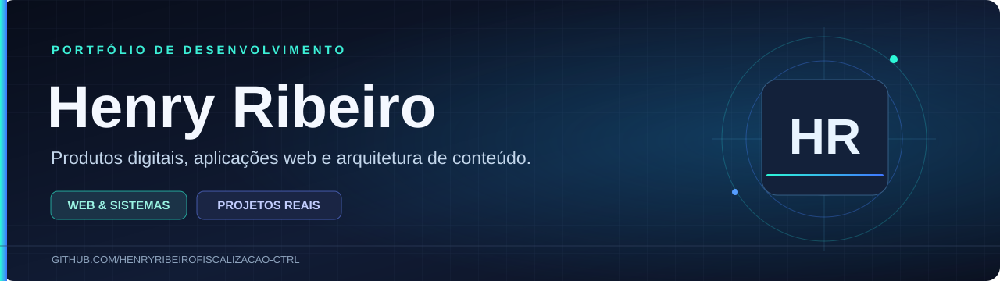
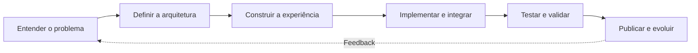

 

**Desenvolvimento de produtos digitais com identidade, propósito e engenharia.**

---

### Olá, sou Henry Ribeiro.

Trabalho no desenvolvimento e na evolução de **sites, portais de conteúdo e sistemas administrativos**. Gosto de criar interfaces marcantes, mas também de resolver o que acontece por trás delas: modelagem de informações, fluxos de publicação, integrações, organização do código e manutenção.

Minha atuação combina desenvolvimento web e interesse contínuo por arquitetura de software, bancos de dados e segurança da informação.

> **Meu foco:** transformar necessidades reais em aplicações utilizáveis, consistentes e preparadas para evoluir.

### Tecnologias presentes nos meus projetos

*Stack baseada nos manifestos de dependências dos projetos; cada aplicação utiliza apenas os componentes relevantes para seu escopo.*

## Projetos selecionados

<table>
<tr>
<td width="52%" valign="top">

### 📰 Sem Filtro Notícias

**Portal jornalístico e ecossistema editorial**

Plataforma voltada à publicação de notícias, administração de matérias e estruturação de portais regionais com identidade visual própria.

**Áreas de trabalho**
- Experiência editorial responsiva
- Gerenciamento de conteúdo
- Componentes e rotas de navegação
- Evolução de múltiplos portais
- Validação e manutenção do projeto

**React · TypeScript · Next.js · Tailwind**

[🌐 Ver projeto publicado](https://www.tvsemfiltronoticias.com.br) · [📘 Estudo de caso](./docs/sem-filtro-noticias.md)

</td>
<td width="48%" valign="top">

### 📚 Mundo dos E-books

**Plataforma de conteúdo e leitura digital**

Projeto orientado à organização de e-books, interfaces de leitura e administração de materiais digitais.

**Áreas de trabalho**
- Experiência de leitura
- Fluxos de catálogo e conteúdo
- Recursos associados a documentos PDF
- Ferramentas editoriais
- Validação de funcionalidades

**React · Vite · libSQL · Tiptap · PDF.js**

[📘 Estudo de caso](./docs/mundo-dos-ebooks.md) · *Demonstração sob consulta*

</td>
</tr>
</table>

## Engenharia por trás das interfaces

Uma boa experiência visual depende de decisões técnicas que o visitante nem sempre vê.

| Pilar | O que considero no desenvolvimento |
| :-- | :-- |
| **Arquitetura** | Divisão de responsabilidades e organização do projeto |
| **UX/UI** | Legibilidade, responsividade e consistência entre telas |
| **Dados** | Estrutura e integração coerentes com o modelo de negócio |
| **Qualidade** | Testes, typecheck, lint e validação de fluxos quando aplicáveis |
| **Segurança** | Gestão de acesso, proteção de segredos e atenção a dados sensíveis |
| **Evolução** | Versionamento, manutenção e mudanças incrementais |

### Do problema à solução

*Fluxo geral de trabalho, não um diagrama da infraestrutura interna dos sistemas.*

## Transparência técnica e confidencialidade

Meus estudos de caso apresentam **contexto, tecnologias e desafios reais**. Os repositórios de produção permanecem privados para resguardar implementações, configurações e informações de projeto.

**O que está disponível aqui:** portfólio público, tecnologias verificadas, estudos de caso e acesso aos projetos publicados.

**O que não está disponível:** credenciais, dados internos, código-fonte proprietário ou acesso administrativo.

## Vamos conversar sobre tecnologia?

Estou aberto a trocar experiências com profissionais de desenvolvimento e segurança da informação e a conversar sobre novos projetos digitais.

**[GitHub](https://github.com/henryribeirofiscalizacao-ctrl)** · **[Sem Filtro Notícias](https://www.tvsemfiltronoticias.com.br)** · **[Estudo de caso editorial](./docs/sem-filtro-noticias.md)**

---

Henry Ribeiro · Desenvolvimento web e sistemas digitais

