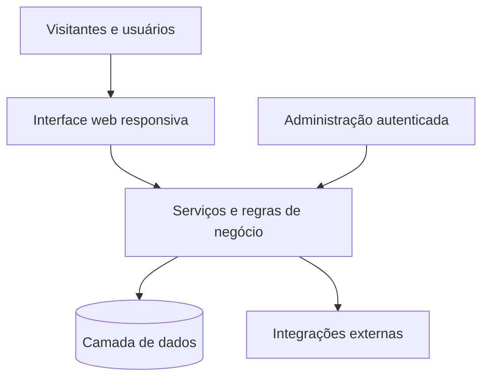

# Como desenvolvo · Processo e decisões de engenharia

[← Voltar ao portfólio](../README.md)

Este documento descreve uma **abordagem de trabalho**, e não uma certificação ou uma auditoria dos sistemas apresentados.

## 1. Entender o problema

Antes de alterar uma aplicação, procuro definir: quem utiliza a funcionalidade, qual problema precisa ser resolvido, que informações ela manipula e quais comportamentos são esperados.

**Entregáveis possíveis:** mapa de páginas, regras de negócio, fluxo de navegação e critérios de aceite.

## 2. Estruturar a solução

Uma arquitetura clara reduz o risco de mudanças locais afetarem funcionalidades que já estão em operação.

*Diagrama conceitual de responsabilidades. Não representa os endpoints, provedores ou a topologia exata dos sistemas.*

Princípios utilizados nas decisões de projeto:
- Separação entre a interface e as regras de negócio.
- Persistência e consultas adequadas ao domínio.
- Respeito às permissões de usuários e administradores.
- Configuração independente quando uma aplicação atende várias identidades ou organizações.

## 3. Construir uma boa experiência

Os elementos visuais devem ajudar o usuário a navegar, não competir com o conteúdo.

**Pontos de revisão:** contraste, tipografia, hierarquia visual, tamanhos de tela, carregamento de imagens, estados vazios, falhas de rede e clareza de ações.

## 4. Validar alterações

Os repositórios dos projetos incluem combinações de scripts para builds, checagem de tipos, lint e testes.

Antes de publicar alterações, a intenção é identificar regressões e preservar comportamentos existentes. A existência dos scripts não garante execução automática ou cobertura integral.

**Verificações relevantes:**
- A página carrega em tamanhos de tela diferentes?
- Links, formulários e fluxos administrativos respondem corretamente?
- A alteração interfere em outros módulos ou identidades?
- Mensagens de erro são claras e não revelam dados internos?
- Há meios de reverter a mudança se necessário?

## 5. Considerar segurança e privacidade

Em projetos que possuem áreas administrativas, autenticação e dados de clientes, as preocupações de arquitetura incluem:
- Autorização de acesso, não apenas login.
- Delimitação dos dados por usuário ou organização.
- Proteção de credenciais e segredos de infraestrutura.
- Validação de entrada e tratamento de erros.
- Cuidados adicionais com operações destrutivas, mudanças de banco e deploy.

Estas são preocupações de engenharia; não equivalem à afirmação de que os sistemas foram submetidos a pentest ou certificação independente.

## 6. Evoluir sem perder o controle

Versionamento e alterações graduais tornam mais fácil identificar a origem de problemas, avaliar mudanças e manter o produto coerente com os requisitos originais.

O portfólio prioriza o **problema resolvido, a estrutura do produto e as decisões técnicas**, sem expor bancos, integrações privadas ou códigos proprietários.

## Estudos de caso

- [Sem Filtro Notícias](./sem-filtro-noticias.md)
- [RadarImob](./radar-imob.md)
- [Mundo dos E-books](./mundo-dos-ebooks.md)
